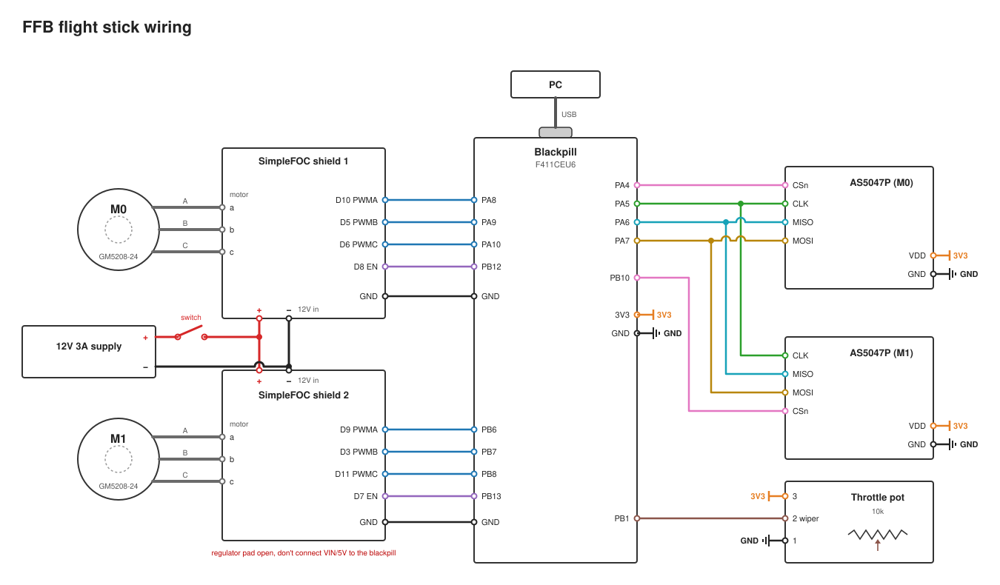

# Wiring

One WeAct Blackpill (STM32F411CEU6) drives both SimpleFOC Shield v2.0.4 boards directly, reads both AS5047P encoders over a shared SPI bus, and reads the throttle pot on an ADC pin. The shields don't plug into the Blackpill, so they're connected with jumper wires to the shield header pins named below.

The diagram is generated by [`wiring_diagram.py`](wiring_diagram.py). Edit the script and re-run `python docs/wiring_diagram.py` to change it.

## Shield solder pads

Each shield picks its PWM and enable pins with solder pads. The two boards use different pads so they can also be stacked.

| Pad | Shield #1 (motor M0) | Shield #2 (motor M1) |
|---|---|---|
| PWM A | D10 | D9 |
| PWM B | D5 | D3 |
| PWM C | D6 | D11 |
| Enable | D8 | D7 |
| LM7808 regulator | **open** | **open** |
| Current sense A / B | not used | not used |

## Blackpill ↔ shields

| Signal | Shield #1 pin | Blackpill | Shield #2 pin | Blackpill |
|---|---|---|---|---|
| PWM A | D10 | PA8 (TIM1_CH1) | D9 | PB6 (TIM4_CH1) |
| PWM B | D5 | PA9 (TIM1_CH2) | D3 | PB7 (TIM4_CH2) |
| PWM C | D6 | PA10 (TIM1_CH3) | D11 | PB8 (TIM4_CH3) |
| Enable | D8 | PB12 | D7 | PB13 |
| Ground | GND | GND | GND | GND |

Each motor's three PWM signals are on channels 1–3 of a single timer (TIM1 for M0, TIM4 for M1).

## Blackpill ↔ AS5047P encoders (SPI1)

| AS5047P pin | Encoder #0 (M0) | Encoder #1 (M1) |
|---|---|---|
| CSn | PA4 | PB10 |
| CLK | PA5 (shared) | PA5 (shared) |
| MISO | PA6 (shared) | PA6 (shared) |
| MOSI | PA7 (shared) | PA7 (shared) |
| VDD | 3V3 | 3V3 |
| GND | GND | GND |

Set each breakout for 3.3 V operation. On the AS5047P that means VDD tied to VDD3V3; check the jumper or pads on your board.

Mount a diametrically magnetised magnet on the back of each motor shaft, centred over the chip.

## Throttle pot (Bourns PDB181, 10 kΩ linear)

| Pot pin | Connects to |
|---|---|
| 1 (end) | GND |
| 2 (wiper) | PB1 (ADC1_IN9) |
| 3 (end) | 3V3 |

If the throttle reads backwards, swap pins 1 and 3 or invert the value in firmware.

## Power

| From | To |
|---|---|
| 12 V supply + | SW1 → TB_PWR + on both shields |
| 12 V supply − | TB_PWR − on both shields |
| PC USB | Blackpill USB-C (power + HID) |

- The supply isn't in `BOM.csv` yet. A 12 V, ≥3 A DC brick is enough, and 12 V matches `driver.voltage_power_supply = 12` in the firmware. The shield accepts 12–24 V.
- SW1 is a power and kill switch on the 12 V line. Keep it in reach: this device puts motor torque into your hand.
- Power the Blackpill from USB only. **Never connect a shield's VIN or 5V pin to the Blackpill**: VIN carries 8 V when the shield's regulator pad is bridged.
- All grounds are common: PSU −, both shield GNDs, the Blackpill, both encoders and the pot.

## Notes

- **Motor phases:** order a/b/c doesn't matter, because `initFOC()` finds the direction and electrical zero at startup.
- **Current sense:** the shield outputs (A0–A3) aren't used by the voltage-mode torque loop, so leave them unconnected. If you add current sensing later:
  - Set the shield's ADC-range pad to **3.3 V**. The Blackpill's analog pins are not 5 V tolerant.
  - Use the spare ADC pins PA1, PA2, PA3 and PB0.
- **SPI wiring:** keep leads short (≤20 cm) and twist each one with a ground wire.
- **Pins to avoid:**
  - PA0 is the KEY button.
  - PA11/PA12 are USB.
  - PA13/PA14 are SWD.
  - PB2 is BOOT1.
  - PC13 is the onboard LED.
  - PB11 doesn't exist on the F411CEU6.

## Firmware status

The firmware in `firmware/` was written for the earlier hardware: two B-G431B-ESC1 boards, each running its own `motor_node` and talking to the Blackpill over UART. With the SimpleFOC Shields in `BOM.csv`, there's no MCU on the driver boards. The Blackpill has to run both FOC loops itself (two `BLDCDriver3PWM` + two `MagneticSensorSPI`) using the pin map above, so the firmware needs porting.
